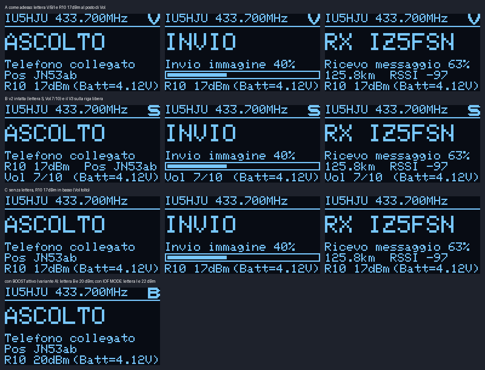
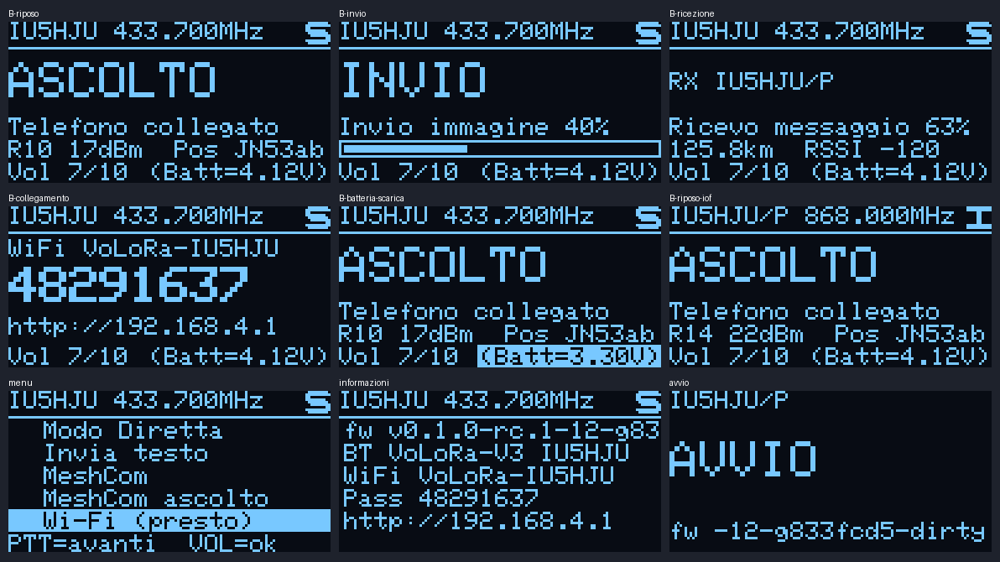

# Display OLED della scheda mobile V3

**Stato:** modello delle schermate **provato sul PC** (`firmware/v3/tests/test_display.cpp`, 61 controlli); disegno su OLED (`display_oled.h`) **compilato dalla CI, mai visto su uno schermo vero**. Le schermate qui sotto sono il testo prodotto dalla prova, non foto.

Il display è quello della **v2** ([docs/display.md della v2](../third_party/VoLoRa-v2/docs/display.md), `src/ui.cpp`), con le stesse regole: SSD1306 128×64 (T3: a bordo, SDA 21 / SCL 22, indirizzo 0x3C poi 0x3D; T-Beam: esterno e facoltativo, se non c'è tutto resta muto), riga 1 con nominativo e frequenza, linea a y=10, **riga grande a y=16** (10 caratteri, oltre passa al testo piccolo), **righe piccole a y=38 e y=47** (21 caratteri, mai a capo), ultima riga a y=56 con **la batteria a destra** nel formato `(Batt=4.12V)` e in negativo sotto 3,40 V, barra di avanzamento sulla riga 47, avviso a tempo sulla riga 38, schermata di avvio con `fw <versione>`.

## Cosa cambia rispetto alla v2 (scelta B dell'autore, 27/11/2026)
**La v2 resta intatta e gli elementi del V3 si aggiungono dove c'è posto** (esempi nel paragrafo "Come affiancare…" più sotto):
- **Lettera in alto a destra:** quella della v2, **S** (Standard), fissa perché nel V3 mobile non ci sono profili. Con **BOOST** diventa **B** e con **IOF MODE** **I**, come la v2 cambia la lettera in T durante MeshCom: è il segnale del livello a rischio.
- **Ultima riga:** `Vol 7/10` e la batteria, come la v2. **Il volume è un segnaposto fisso** (il V3 non ha audio): finché non c'è la voce non cambia con i tasti.
- **Riga libera a riposo (y=47):** `R10 17dBm  Pos JN53ab` (gradino, potenza, posizione) oppure `R10 17dBm  GPS 8sat` con il GPS acceso. **Durante un invio** la riga è occupata dalla barra di avanzamento, quindi il gradino e la potenza non si vedono; **durante la ricezione** la riga dice distanza e RSSI come nella v2; dopo una ricezione, per 20 s, byte e CRC.
- **Niente PTT, niente volume funzionante:** si manda dal telefono.
- **Schermata di collegamento:** senza telefono collegato la scheda non può né mandare né accettare oggetti, quindi mostra come collegarlo: con il **Wi-Fi della scheda** (firmware `mobile_*`) la rete `WiFi VoLoRa-<NOMINATIVO>`, la **password a 8 cifre in carattere doppio e in grassetto** (come la schermata Wi-Fi della v2) e l'indirizzo `http://192.168.4.1`; con il Bluetooth il **codice a 6 cifre** e il nome `VoLoRa-V3 <NOMINATIVO>`. Non serve più il computer per leggere la password o il codice.
- **Avvisi a tempo (4 s):** `CONSEGNATO`, `INVIO FALLITO`, `ANNULLATO`, `MANCA LA POSIZIONE`, `IMPOSTA NOMINATIVO`, `OCCUPATO`.
- **Comando seriale** `DISPLAY 0` / `DISPLAY 1`: lo spegne e lo riaccende (disegnare costa circa 25 ms; durante una prova radio serrata conviene spegnerlo).
- Il ridisegno avviene solo se la schermata cambia, al massimo 10 volte al secondo, a 4 Hz durante un invio o una ricezione (come la v2).

## Le schermate
```
Avvio (1,8 s)                  A riposo                        Senza telefono
| IU5HJU                |      | IU5HJU 433.700MHz     |V      | IU5HJU 433.700MHz     |V
| AVVIO       (grande)  |      | ASCOLTO     (grande)  |       | Collega il telefono   |
| fw v0.1.0-rc.1        |      | Telefono collegato    |       | [917558]   (doppio)   |
                               | Pos JN53ab            |       | VoLoRa-V3 IU5HJU      |
                               | R10 17dBm (Batt=4.12V)|       | R10 17dBm (Batt=4.12V)|

Invio dal telefono             Ricezione dalla radio           Ultimo ricevuto (20 s)
| IU5HJU 433.700MHz     |V     | IU5HJU 433.700MHz     |V      | IU5HJU 433.700MHz     |V
| INVIO       (grande)  |      | RX IZ5FSN   (grande)  |       | ASCOLTO     (grande)  |
| Invio immagine 40%    |      | Ricevo messaggio 63%  |       | Ultimo IZ5FSN         |
| [barra ######      ]  |      | RSSI -97  SNR 7.5     |       | 5000 byte CRC ok      |
| R7 17dBm  (Batt=4.12V)|      | R7 17dBm  (Batt=4.12V)|       | R7 17dBm  (Batt=4.12V)|
```
Altre: `SOLO RX / Imposta il nominativo` (senza nominativo, con il codice Bluetooth sulla riga 47), `ERRORE / radio` (la radio non parte), `Cerco il collegamento` (collegamento perso durante l'invio), nominativo di 8 caratteri (`RX IU5HJU/P`: la riga grande scende al testo piccolo, come la v2).

## Come affiancare gli elementi della v2 e quelli del V3: esempi (da scegliere con l'autore)
Il V3 mobile non ha PTT né volume, quindi due elementi della v2 non hanno più il loro significato: la **lettera del profilo** (S/R/M/D/T) e **`Vol 7/10`**. Prima ho messo al loro posto la lettera V/B/I e `R10 17dBm`; l'autore ha chiesto (27/11/2026) di **aggiungere gli elementi V3 a quelli della v2** e di vedere degli esempi, e ha scelto la **B**: 
Tre varianti sullo stesso schermo (a riposo, invio, ricezione): **A** com'era; **B** (scelta) la v2 intatta (lettera S e `Vol 7/10`) con il V3 sulla riga libera, che a riposo basta ma durante l'invio con la barra non c'è più posto (il gradino non si vede); **C** senza lettera e senza `Vol`. Nota (A e C): con `R10 17dBm` (9 caratteri) e la batteria (12) la riga è piena e le due scritte si toccano; con la B no. È un **mockup** disegnato con le coordinate della v2 (`tools/render_display_v3.py`, che usa lo stesso modello di Adafruit_GFX della v2), non una foto.

## Le varianti A e C sono conservate: come riprenderle
La **B** è la disposizione scelta e quella predefinita. La **A** e la **C** non sono andate perse: restano nel codice, provate dai test, e si possono riprendere e modificare.
- **Nel codice:** `firmware/v3/src/display_model.h`, `enum class Layout { A, B, C }` con la descrizione delle tre disposizioni in testa; `Input::layout` la sceglie (la B se non si dice niente). Cambiano tre cose: la **lettera** in alto a destra (A: V normale / B / I; B: S della v2 / B / I; C: nessuna / B / I), il **testo in basso a sinistra** (A e C: `R10 17dBm`; B: `Vol 7/10`) e la **riga libera a riposo** (A e C: stato del GPS o posizione come nella v2; B: gradino, potenza e posizione). Il disegno (`display_oled.h`) non cambia: con la C la lettera non c'è (`Screen::badge == 0`).
- **Per provarle sulla scheda senza toccare il codice:** aggiungere `-DVL3_DISPLAY_LAYOUT=A` (oppure `C`) ai `build_flags` di un ambiente di `firmware/v3/platformio.ini` e ricompilare. Per cambiare il valore di partenza basta la macro in testa a `main_mobile.cpp`.
- **Test:** `firmware/v3/tests/test_display.cpp` verifica la B e, in un ciclo a parte, la A e la C (lettera, testo in basso, riga libera, BOOST, IOF MODE, invio con la barra).
- **Mockup:** `python3 tools/render_display_v3.py PERCORSO/glcdfont.c` rigenera `docs/images/display-v3-esempi.png` con le tre varianti (stato a riposo, invio, ricezione); le funzioni `variant_a`, `variant_b`, `variant_c` sono i tre schermi. Per ridisegnare una variante basta cambiare quella funzione. Il file `glcdfont.c` è nella libreria Adafruit-GFX.
- **Difetto noto della A e della C:** `R10 17dBm` (9 caratteri) più la batteria (12) riempiono la riga di 21 caratteri e le due scritte si toccano; con la B no.

## Accuratezza del disegno: la libreria vera (Adafruit)
**Cosa ho verificato il 27/11/2026** (prima avevo usato solo le regole della v2 e una copia vecchia della libreria sul disco):
- **Versioni fissate.** In `firmware/v3/platformio.ini` (e `firmware/misura/platformio.ini`) ora ci sono **Adafruit SSD1306 2.5.16**, **Adafruit GFX Library 2.0.0** e **Adafruit BusIO 1.17.4**: sono quelle che la CI risolveva (la GFX non era fissata e PlatformIO prendeva "l'ultima"). Le ho lette dal registro di installazione della CI.
- **Sorgenti letti** (scaricati da GitHub, tag `2.0.0` e `2.5.16`): il font 5×7 di `glcdfont.c` è **identico byte per byte** a quello della versione 1.2.9 usata per i primi mockup (1280 byte); `Adafruit_GFX::write()` fa avanzare `6 × dimensione` punti per carattere e va a capo oltre i 128 punti (21 caratteri a dimensione 1, 10 a dimensione 2); la nuova modalità UTF-8 è **spenta di base** (`_utf8 = false`), quindi il testo si disegna come prima; il testo nero senza sfondo (per la voce scelta in negativo) non disegna lo sfondo. `Adafruit_SSD1306::begin()` disegna nel buffer il logo Adafruit, ma noi cancelliamo e mostriamo lo schermo vuoto subito dopo, come la v2.
- **Prova sul PC con la libreria vera:** il disegno è in `firmware/v3/src/display_draw.h`, che usa solo l'API di Adafruit_GFX; `tests/test_oled_real.cpp` lo disegna con la **vera Adafruit_GFX 2.0.0** (scaricata da GitHub e compilata sul PC con un minimo di Arduino finto, `tests/arduino_stub`) su un canvas da 128×64 a 1 bit e controlla, per tutte le schermate e le tre disposizioni A, B e C: **nessuna scritta va a capo da sola**, la prima riga non tocca la lettera in alto a destra (nominativo di 8 caratteri a 868 MHz), il testo a sinistra dell'ultima riga non si sovrappone alla batteria, la batteria scarica è un riquadro pieno, la password a 8 cifre in carattere doppio sta nello schermo, la voce del menu scelta è in negativo. Prova che serve davvero: togliendo il taglio a 21 caratteri e dando una riga troppo lunga, il test lo segnala (4 errori).
- **Schermate vere della libreria:**  (disposizione B: a riposo, invio, ricezione, collegamento con la password Wi-Fi, batteria scarica, IOF MODE con nominativo di 8 caratteri e 868 MHz, menu, informazioni, avvio con la versione lunga). Generata da `tools/pbm_to_sheet.py` a partire dai PBM del test.
- **Come si usa:** `make -C firmware/v3 oled-real` (fa anche parte di `make test`; senza rete la prova si salta e lo dice). `./build/test_oled_real build/oled` scrive anche ogni schermata come immagine PBM (`P1`, 128×64 punti): è il disegno vero della libreria, non un mockup, e si può guardare con qualunque visualizzatore o convertire in PNG.
- **Non verificato:** l'aspetto su un OLED vero (contrasto, pixel difettosi, indirizzo I2C, tempo di disegno di circa 25 ms con la radio in ricezione) e il comportamento della libreria SSD1306 sul bus I2C della scheda.

## GPS e distanza (T-Beam)
Come la v2: a riposo la riga 47 dice `GPS fix, 8 satelliti` oppure `GPS cerco satelliti` (con il GPS acceso, `GPS ON` sulla seriale); durante la ricezione `12.3km  RSSI -97`; dopo `Ultimo IZ5FSN 12.3km` (la distanza si aggiunge solo se la riga resta nei 21 caratteri). Vedi [firmware-v3.md](firmware-v3.md).

## Batteria
Come la v2 (`src/battery.cpp`), lettura non bloccante: **T-Beam** dal chip AXP2101 ogni 2 s (`(Batt=--)` se la batteria non c'è); **T3** ADC su GPIO35 con partitore 100k/100k, calibrazione del chip, media di 16 letture (una ogni 50 ms) e media lenta di circa 2,5 s (senza batteria e con USB si legge la linea del caricatore, che oscilla).

## Versione del firmware
All'accensione `fw <versione>` come la v2: viene da `git describe --tags --always --dirty` (script `firmware/v3/tools/git_version.py`, copia di quello della v2); se è più lunga di 18 caratteri si mostra la coda, che ha il codice del commit. Sulla pagina di installazione compare la stessa versione.

## Dove sta nel codice
| Cosa | File |
|---|---|
| Modello delle schermate (testi, regole dei 21 e 10 caratteri, lettere, glifi) | `firmware/v3/src/display_model.h` |
| Disegno sull'OLED (Adafruit SSD1306, stesse coordinate della v2) | `firmware/v3/src/display_oled.h` |
| Batteria: formato, soglia, medie | `firmware/v3/src/battery_info.h`, `battery_board.h`, `pmu.h` |
| Collegamento allo stato della scheda | `firmware/v3/src/main_mobile.cpp` (`updateDisplay`) |
| Prove | `firmware/v3/tests/test_display.cpp` |

## Cosa NON è fatto
- **Non visto su un OLED vero:** coordinate e testi vengono dalla v2, ma nessuno ha ancora guardato una schermata V3 su uno schermo. Il costo di ridisegno (25 ms) con la radio in ricezione serrata va misurato.
- Il display non c'è nel firmware **a banco** (`bench_*`) e nel **ponte simulato** (`ble_sim_*`).
- Niente schermate di menu né di MeshCom, Wi-Fi, prova di potenza, casella messaggi: nel V3 mobile non esistono ancora le funzioni (vedi il confronto con la v2 in [firmware-v3.md](firmware-v3.md)).
